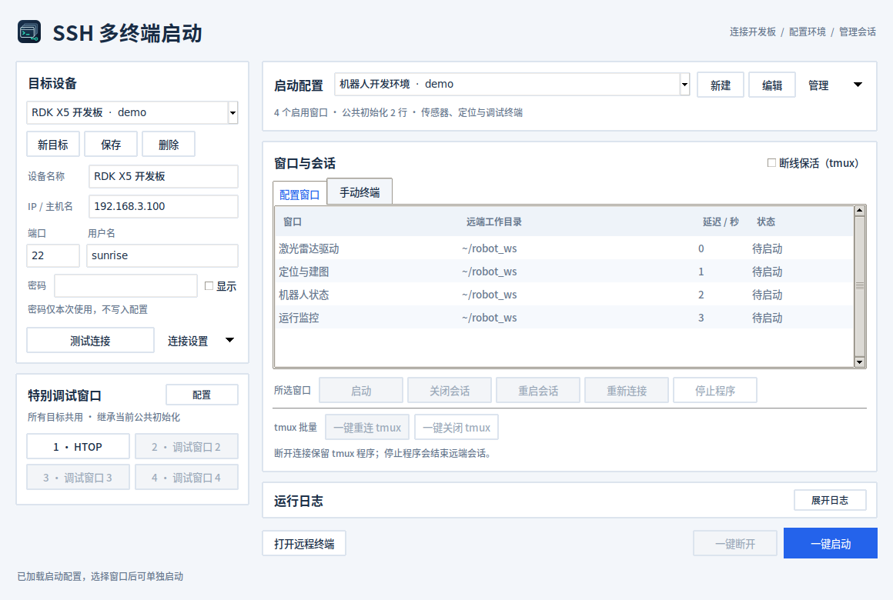

# SSH 多终端启动工具

选择本机或远程设备及启动配置，一键打开多个终端，分别配置环境并启动程序。远程模式通过SSH连接RDK X5等Ubuntu设备；本机模式直接使用当前电脑的Bash，无需SSH服务或密码。

首版采用Python、Tkinter及Paramiko。Ubuntu桌面的多终端运行需要GNOME Terminal；Windows目前可编辑配置及测试连接，不提供多窗口启动。源码版支持 Ubuntu 20.04、22.04、24.04、26.04 的常规桌面环境和 CPython 3.8–3.14，版本与实测范围见[兼容性说明](docs/compatibility.md)。真实开发板及长期运行验收仍按[验证清单](docs/verification.md)执行。

## Ubuntu 24.04 测试包

使用 `dist/ssh-multi-tool-0.1.0-ubuntu24.04-x86_64.tar.gz`，解压后运行：

```bash
cd ssh-multi-tool
./ssh-multi-tool
```

无需安装Python/pip。Ubuntu默认GNOME桌面通常已有GNOME Terminal，缺失时运行 `sudo apt install gnome-terminal`。可选 `bash install-desktop.sh` 添加应用菜单入口。测试包基于Ubuntu24.04、glibc2.39构建，不承诺在22.04运行。

## Ubuntu 源码版启动

首次准备依赖：

```bash
sudo apt install python3 python3-tk python3-venv gnome-terminal fonts-noto-cjk libglib2.0-bin libatspi2.0-0
bash install-ubuntu.sh
bash start.sh
```

默认使用系统 `python3`，最低版本为 3.8；Tk 和 venv 需与所用解释器版本匹配。需要指定解释器时：

```bash
SSHMT_PYTHON=python3.12 bash install-ubuntu.sh
bash start.sh
```

`start.sh` 优先使用安装生成的 `.venv`。显式设置 `SSHMT_PYTHON` 启动时使用该解释器，它须自行装好 Tk 和项目依赖。Python 3.8 自动安装 Paramiko 3，较新 Python 使用 Paramiko 3/4。

`install-ubuntu.sh`在项目目录创建隔离虚拟环境，首次安装依赖需要网络。之后打开工具不需要联网安装，只需要能访问目标设备。可将命令绑定到桌面快捷方式。

远端需已有SSH服务、Bash、stty及head（Ubuntu默认提供后两项），以及用户程序和ROS依赖。远端不安装本工具，不要求Python或额外常驻服务。

## 界面布局



左侧集中管理目标连接与四个调试槽位；右侧选择启动配置、查看配置窗口和手动终端。列表下方是所选窗口操作，tmux 批量操作单独分组；“启动所选任务”“一键断开”和普通远程终端入口集中在底部。

配置的复制、导入、导出、删除及示例入口位于“管理”菜单；主机信任和超时设置位于“连接设置”。运行日志默认折叠，可随时展开，折叠时仍保留和接收日志；底部持续显示最新操作结果。字体、表格状态颜色和编辑弹窗采用统一样式，仍使用原生 Tk/ttk，不增加界面运行依赖。

## 操作

1. 填目标名称、IP、端口、用户名和密码，可点击“测试连接”。首次连接核对服务器SHA256指纹后信任。
2. 在启动配置区域点击“新建”，或从“管理”菜单选择“导入示例”。公共初始化填写source、export等命令；新建窗口填写工作目录、命令和延迟。
3. 保存配置，在“配置窗口”列表左侧勾选要运行的任务，点击“启动所选任务”。每个勾选的窗口执行同一份公共初始化，再进入自己的目录并运行程序。
4. 在窗口列表选中一行，点击“关闭会话”关闭对应终端并断开SSH，尚在等待的窗口会取消启动；也可点击“重启会话”，验证密码并关闭旧会话后，立即按本轮启动时的配置重新连接执行，不重复等待延迟，也不影响其他窗口。
5. 点击“一键断开”关闭当前工具打开的全部终端（包括上一轮保留的结果窗口），取消延迟任务及进行中的启动/重启。关闭主界面仍会保留已启动的终端。
6. 也可在各终端Ctrl+C停止前台程序。程序结束后终端保留结果，按回车关闭。

建议先导入 `examples/smoke-test.json` 验证基础连接，再使用RDK示例。ROS示例中的发行版、工作空间、包名和脚本名需要按设备修改，不是开箱可用的实际业务程序。

点击窗口列表下方的“打开远程终端”，可使用当前目标和密码打开一个独立的SSH交互窗口，手动输入命令；无需启动配置，可重复打开，也可连接不同目标。新终端显示在独立的“手动终端”标签页，切换配置后仍保留，支持关闭、重启和一键关闭。确认终端窗口关闭后，列表条目及对应配置快照会自动删除，直接关闭终端窗口也会清理；仍停留在结果页的窗口会保留到实际关闭。重启期间会保留条目。配置定义的窗口在“配置窗口”页管理，关闭运行会话不会删除配置行。选择了启动配置时，新终端会先执行该配置的公共初始化，继承其中通过 `source` / `export` 设置的环境变量和 `cd` 目录，再进入交互Bash；初始化失败会停止并保留错误结果。它不执行任何配置窗口的启动命令；未选择配置时使用远端默认登录shell。

“特别调试窗口”提供四个快捷槽位，在“特别调试窗口”区域点击“配置”编辑各槽的名称和 Bash 命令，支持多行。设置保存在本机偏好中，所有目标开发板共用，不写入或导出到启动配置文件。第一个槽位默认运行 `htop`（远端须已安装），其余三个默认留空；空槽位不能启动。

选择目标和启动配置并输入密码后，点击槽位按钮即可打开调试窗口：先执行当前配置的公共初始化，继承环境变量和目录，再执行槽位命令。公共初始化失败时不会执行调试命令。调试窗口在“手动终端”页管理，支持关闭、重启和一键关闭，窗口实际关闭后自动移除；重启沿用该窗口启动时的配置和槽位命令，修改槽位只影响后续新窗口。

在当前配置的窗口列表中选中一个启用的窗口，点击“所选窗口”操作栏中的“启动”，立即执行公共初始化、该窗口的工作目录切换和启动命令，不等待配置中的批量启动延迟。其他窗口不受影响；已在等待、连接或执行中的窗口不能重复启动，状态未知时需先关闭。可以逐个启动同一目标、同一配置中的不同窗口；其他目标或配置存在活动任务时须先关闭。

下次打开自动恢复上次保存的目标及配置，密码重新输入。切换已保存目标会清空密码。配置选择即时保存，编辑内容须点击保存。

## 勾选批量启动任务

“配置窗口”列表最左侧提供任务勾选框，默认勾选所有已启用的任务。点击勾选框逐项选择，也可点击表格上方的“全选 / 取消全选”一次切换；部分勾选时显示半选状态。选中某一行后按空格也可切换该任务的勾选状态。配置中已禁用的窗口显示“—”，须先在编辑器启用后才能勾选。

点击“启动所选任务”只运行本次勾选的任务，并保留各任务原有的启动延迟、公共初始化及工作目录；未勾选任何任务时按钮禁用。点击任务名称选中行，仍可单独启动、关闭、重启或双击预览命令，行选中与批量勾选相互独立。

勾选结果在本次打开工具期间按配置分别保留，切换配置或本机/远程模式后仍可使用；重开工具默认勾选所有已启用任务。它不修改保存或导出的配置，也不会改变已经调度的任务。运行中重新勾选，仅影响下一次批量启动。

## 本机启动

在左侧“启动位置”选择“本机”，选择或新建启动配置，再点击“启动所选任务”。无需填写设备地址、用户名或密码；公共初始化、工作目录、命令和启动延迟均在当前电脑执行，所需程序和ROS环境须安装在本机。启动位置会自动记住，切回“远程 SSH”可继续使用已保存的设备。

本机模式支持所选窗口单独启动、关闭、重启及一键断开；重启沿用窗口启动时的配置快照。点击“打开本机终端”可进入交互Bash，选有配置时继承公共初始化；特别调试窗口也在本机执行。本机终端集中在独立的GNOME Terminal窗口，与远程设备分开。

目前本机启动支持Ubuntu桌面，仍需要GNOME Terminal。本机模式不使用tmux保活，开关暂时禁用；切回远程模式恢复原设置。退出主界面保留已启动的终端，关闭终端或会话操作会结束对应的普通本地任务；自行脱离终端的服务或nohup程序可能继续运行。

## 按开发板集中管理会话

同一主机、SSH端口和用户的会话集中在一个GNOME Terminal窗口，配置任务、普通SSH和调试任务各使用一个标签页；不同开发板分别使用窗口。关闭某个标签页后，其他标签页继续运行；关闭GNOME整个窗口会断开该开发板窗口中的全部会话。主界面的“关闭会话”和“重启会话”只处理选中的会话。

特别调试按钮默认复用同一开发板、同一槽位的活动会话，不重新验证密码或重复执行命令，并在“手动终端”页选中已有会话。工具会尝试切换对应终端标签页并聚焦窗口；若桌面辅助功能或窗口管理器阻止聚焦，会显示提示，此时手动切换终端即可，会话仍然被复用。需要额外会话时，右键槽位按钮选择“新开会话”。已结束的调试任务再次点击会新建会话；重启工具不会接管旧终端。

## 命令规则

公共初始化在每个窗口重复执行，只放环境初始化和快速检查，不要放只应执行一次的硬件重置或常驻程序。

```bash
source /opt/ros/humble/setup.bash
source ~/robot_ws/install/setup.bash
export ROS_DOMAIN_ID=10
export RMW_IMPLEMENTATION=rmw_cyclonedds_cpp
```

每窗口命令是完整Bash片段，环境和cd在同一shell中延续。默认启用 `set -e` 和 `pipefail`，初始化失败停止当前窗口后续程序。条件语句、函数等仍遵守Bash自身退出规则。多个常驻程序建议分窗口运行，后续命令会等待前一条前台程序退出。

工作目录支持留空、绝对路径和 `~/` 路径。目录字段不展开 `$VAR` 或命令替换。延迟秒数相对本轮共同启动起点，不能保证ROS节点已就绪。

## 断线保活（tmux）

勾选窗口列表下方的“断线保活（tmux）”，之后新开的配置窗口、手动 SSH 终端和特别调试窗口会运行在远端 tmux 中。目标开发板须已安装且能运行 tmux；工具启动前检查，不会自动安装。开关保存在本机偏好中，不写入启动配置 JSON，也不会改变已有窗口的模式。

- “断开窗口”及“一键断开”只关闭本机连接，保活程序继续运行；直接关闭终端标签页或网络断开也保留远端会话。
- “重新连接”仅附着原会话，保留环境和终端输出，不重复执行公共初始化或启动命令。原会话消失时提示失败，请使用“重启会话”重新启动。
- “一键重连 tmux”尝试恢复本轮管理的全部已断开保活窗口，跳过已连接窗口；每项独立处理，失败不影响其他窗口。重连发起后，以列表和终端中的实际连接结果为准。
- “一键关闭 tmux”直接停止所有受管理的远端 tmux 会话，无需先重连；取消 tmux 延迟启动，保留普通模式任务。确认停止后释放对应配置的启动限制，失败项保留，可再次点击重试。远端会话已经不存在也视为停止成功。
- 当前目标复用主界面中的密码，其他目标分别提示输入密码；取消或留空只跳过该目标。密码仅用于本次批量操作，不写入文件。批量操作期间可用“一键断开”取消尚未处理的项目。
- “停止程序”结束选中窗口的 tmux 会话，关闭其终端；手动保活条目随后删除。无法连接目标时保留记录，方便稍后处理。
- “重启会话”先验证连接并结束旧 tmux 会话，再按该窗口启动时的配置快照重新初始化和执行。

保活手动窗口断开后仍显示在“手动终端”页。配置窗口的后台会话仍占用当前批次，必须明确停止后才能切换启动另一批配置，避免丢失管理入口。特别调试按钮会重连已断开的保活槽位；右键“新开会话”仍创建独立会话。公共初始化仅在创建会话时执行。命令结束后面板保留输出，状态显示终端连接状态，不表示命令仍在运行。tmux 不能抵御开发板重启，也不保证结束已脱离终端的服务或 nohup 进程。

工具重开后，勾选保活并启动相同目标和配置窗口（或相同调试槽位）会复用远端已有会话；此时新编辑的命令不会再次执行，需明确重启。随机新开的手动窗口记录目前只保存在本轮主界面内。关闭主界面后远端仍保留，可在目标上用 `tmux -L ssh-multi-tool list-sessions` 查看，并用 `tmux -L ssh-multi-tool attach-session -t <会话名称>` 恢复；会话名称以 `smt_` 开头。工具使用独立 tmux 服务，不改动用户默认 tmux 会话。

## 生命周期及限制

关闭主界面取消尚未启动的任务，已启动的终端独立继续执行。以下说明适用于未启用 tmux 的普通窗口。关闭终端会断开SSH，但不能保证所有远端子进程退出；nohup、后台化及服务启动的程序可能继续运行。

启动配置一次只运行一批活动任务，避免重复运行；可另外打开多个独立远程终端。重开主界面不会接管旧终端，也不会自动启动程序；再次启动前请检查已有终端及远端进程。工具不自动重试程序、不检测ROS节点健康；窗口关闭及重启通过断开SSH结束会话，不保证清理远端后台进程。重启使用各窗口启动时的配置快照；编辑并保存配置后，新开的远程终端及“所选窗口”的“启动”会采用当前配置，已有窗口不受影响；切换目标后需切回对应窗口的原目标并输入密码才能重启。

密码只通过内存及受限本机通信传递，不写进配置、参数或临时脚本。主机指纹变化会阻止连接，需要核验后使用“主机信任管理”更新。配置中的自写命令可执行任意远端操作，导入时须检查全部命令，分享前检查是否含秘密。

## 本地文件

Ubuntu：`${XDG_CONFIG_HOME:-~/.config}/ssh-multi-tool/`。Windows编辑模式：`%APPDATA%/ssh-multi-tool/`。

- `profiles/`：可分享JSON启动配置。
- `targets.json`：设备信息，不含密码。
- `preferences.json`：上次选择、窗口尺寸、连接超时、启动位置、断线保活开关及四个特别调试槽位的名称和命令。
- `known_hosts`：工具独立的主机信任记录，不修改系统SSH配置。

损坏配置会跳过并显示原因。导入后先在编辑器检查并保存，导入和选择不会执行程序。

若目标或偏好文件损坏，新数据保存前会把原文件完整备份为同目录的 `targets.json.recovery-*` 或 `preferences.json.recovery-*`，便于手动恢复；备份失败则停止覆盖。

## 开发与测试

```bash
python3 -m venv .venv
.venv/bin/python -m pip install -r requirements.txt
.venv/bin/python -m unittest discover -s tests -v
```

安装 tmux 后会执行实际保活、重连、大脚本及停止隔离测试；未安装时这些集成测试会跳过。没有图形显示时GUI测试会跳过，可用 `xvfb-run -a .venv/bin/python -m unittest discover -s tests -v` 执行GUI冒烟测试。Linux测试包含Unix socket权限和Bash语义。Windows可选设置 `SSHMT_TEST_BASH` 指向MSYS Bash以运行Bash语义测试，这不替代Ubuntu PTY验收。

## 构建可分发 Ubuntu 包

在Ubuntu x86_64运行：

```bash
sudo apt install binutils libpython3-dev
bash packaging/build-ubuntu.sh
```

输出为 `dist/ssh-multi-tool-0.1.0-<发行版版本>-x86_64.tar.gz`，例如 `ubuntu24.04`。目录式包内包含Python、Tk及SSH依赖，接收者无需Python/pip，仍需GNOME Terminal及图形桌面。在解压目录运行 `./ssh-multi-tool`；可选 `bash install-desktop.sh` 添加应用菜单入口。

构建脚本收集第三方许可证，缺失时停止并要求补齐。构建通过不等于可发布，各目标 Ubuntu 版本应分别按[验证清单](docs/verification.md)验收。

## 应用图标

项目自带原创 SVG 图标和 16–512 像素 PNG；窗口使用多个尺寸的内置 PNG，源码启动、Python wheel 安装和 Ubuntu 分发包均包含资源，不依赖当前工作目录或额外图像库。桌面入口使用 `Sshmultitool` 窗口标识匹配应用，图标安装到当前用户的标准 `hicolor` 目录。

源码用户可运行 `bash packaging/install-desktop.sh` 安装或更新应用菜单入口；Ubuntu 分发包仍运行解压目录中的 `bash install-desktop.sh`。已经安装旧入口的用户需要重新执行一次该脚本，并关闭旧窗口再启动。程序目录移动后也需重新安装入口。

图标源文件位于 `ssh_multi_tool/assets/app-icon.svg`。维护者安装 `python3-gi python3-cairo gir1.2-rsvg-2.0` 后，可运行 `python3 packaging/render-icon.py` 重新生成 PNG；这些依赖仅用于修改图标，用户运行应用无需安装。

## 文档

- [快速入门](docs/quickstart.md)
- [设计规格](docs/superpowers/specs/2026-10-11-ssh-launcher-design.md)
- [实现计划](docs/superpowers/plans/2026-10-11-ssh-launcher.md)
- [验证记录与平台验收](docs/verification.md)

本项目代码采用MIT许可证，第三方依赖遵守各自许可。

WSL或最小化Ubuntu若中文显示为方框，请运行 `sudo apt install fonts-noto-cjk`，关闭工具后重新打开。预编译包也依赖系统中文字体。
